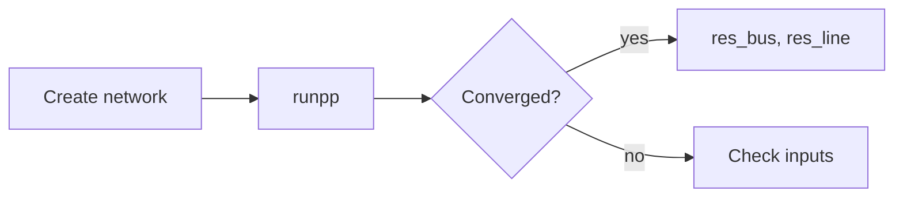

Inline math is written as `\( ... \)`, display math as `$$ ... $$` (MathJax 3, LaTeX syntax).

The complex power injection at bus \\(i\\) is

$$
S_i = V_i \sum_{k=1}^{n} Y_{ik}^{*}\, V_k^{*}
$$

which, split into real and imaginary parts, gives the power flow equations

$$
\begin{aligned}
P_i &= \sum_{k=1}^{n} |V_i||V_k| \left( G_{ik}\cos\theta_{ik} + B_{ik}\sin\theta_{ik} \right) \\
Q_i &= \sum_{k=1}^{n} |V_i||V_k| \left( G_{ik}\sin\theta_{ik} - B_{ik}\cos\theta_{ik} \right)
\end{aligned}
$$

Matrices work as well:

$$
\begin{bmatrix} \Delta P \\ \Delta Q \end{bmatrix} =
\begin{bmatrix} J_{11} & J_{12} \\ J_{21} & J_{22} \end{bmatrix}
\begin{bmatrix} \Delta\theta \\ \Delta |V| \end{bmatrix}
$$

Chemistry (mhchem): \\( \ce{CO2 + H2O <=> H2CO3} \\)

Diagrams (Mermaid):

